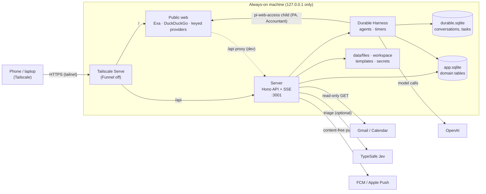

# Architecture

How Zimpoen is built. Section and rule numbers are stable: code comments cite them as `PLAN §5.4` or `PLAN rule 6`
(this file used to be `PLAN.md`). Reasoning behind individual decisions is in [design-notes.md](design-notes.md);
installation is [SETUP.md](SETUP.md).

## 1. Goal

An always-on personal assistant on an old Linux laptop, reached privately over Tailscale from a chat UI (installable as an
Android PWA). Each agent is one long-running Durable conversation:

| Agent | Purpose |
|---|---|
| `pa` | Front door: tasks, reminders, follow-ups, meeting agendas, birthdays, daily briefing and wrap-up, files. Can ask other agents. |
| `inbox` | Gmail (several accounts) and Google Calendar, read-only. Triage, digests, follow-up suggestions to the PA. |
| `health` | Weight, gym lifts, trends. |
| `accountant` | Expenses and income, balances, bill splits, monthly invoice PDFs. |

Model and thinking level are per-agent settings, editable at runtime (stored in Durable via `configure()`). The model is
OpenAI through a ChatGPT subscription sign-in (pi-ai's "Sign in with ChatGPT"); tokens stay on the machine. Anthropic
subscription OAuth is not used: its consumer terms don't allow it.

## 2. Hard rules

1. **No outbound actions.** No tool sends email, posts messages, spends money or contacts anyone. Those tools don't exist.
   Gmail and Calendar use read-only scopes.
2. **Writes are local only:** `app.sqlite`, memory, and generated files in the workspace.
3. **Deletes need explicit approval** (Approve button or a literal "YES"), enforced in code by a `beforeTool` hook, not
   by the prompt.
4. **File access is an allowlist.** Read: `ASSISTANT_READ_PATHS` (default `~/Documents`, `~/Downloads`), `<data>/files`
   and the workspace. Write: `<data>/workspace` only. Always denied, in any case and after resolving symlinks: `.ssh`,
   `.env*`, `auth.json`, `*.pem`, `*.key`, `.netrc`, `.npmrc`, `.aws`, `.git-credentials`, `.gnupg`, `id_*`,
   `<data>/secrets/**`. Startup rejects a read path that would expose the databases.
5. **No shell tool** for any agent. Documents are converted by the server itself (poppler, LibreOffice) with fixed
   arguments; no agent chooses what runs.
6. **The Inbox agent has no file tools,** because it handles untrusted email. Its only tools are `search_mail`,
   `read_mail`, `list_events`, `mark_triage`, `propose_sender_rule`, `suggest_followup`, `recall` and `current_time`. No
   `tool_search`, no approval hook, no `ask_agent`. Email text is treated as data everywhere.
7. **Arithmetic is code, never the model:** splits, balances, totals, invoice numbers.
8. **Every tool write to `app.sqlite` is idempotent by tool call id** (`source_call_id UNIQUE`, or a per-module `*_call`
   table), because Durable may replay a tool after a crash.
9. **Secrets** (`credentials.json`, `vapid.json`, `google-oauth.json`, `google-accounts.json`, `jev.json`, `search.json`) live in
   `<data>/secrets/` (0700, files 0600) and are never readable by an agent.
10. **Server and web bind to `127.0.0.1` only.** Tailscale Serve is the only way in.
11. **The web is read, public only.** The PA and the Accountant have `web_search`, `fetch_content`,
    `get_search_content` and `source_check` from [pi-web-access](https://github.com/nicobailon/pi-web-access), run as an
    MCP child process with a clean environment and its own config in `<data>/web`. Its SSRF guard refuses loopback,
    private ranges, link-local and the tailnet; browser cookies, proxies and provider choice are not offered to agents.
    Web text is untrusted, like email. The Inbox has no web tools.

## 3. Topology



Outbound traffic is to those four services, plus public web pages and the search provider when the PA or the
Accountant searches or reads a page. Push payloads say things like "1 reminder" and never carry content.

Use a non-identifying machine name before enabling Tailscale HTTPS: certificate names are public in transparency logs.
Development uses `./data-dev` and production `./data`, so the two never share a database.

## 4. Repository layout

```text
apps/
  server/       Node 24 process: Harness, HTTP API, SSE, Web Push, Google sync
  web/          Next.js (App Router) + @assistant-ui/react, PWA
packages/
  shared/       API contracts: DTOs, SSE event types, card types
  db/           app.sqlite wrapper and migration runner
  extensions/   Domain modules (Durable extensions)
ops/            systemd units, Tailscale Serve and check scripts
docs/
```

TypeScript strict, ESM. Workspace packages export source; Node 24 runs it directly in dev and `pnpm build` bundles the
server with esbuild. Tests use Vitest and pi-ai's faux provider (no network). Durable packages are pinned exactly; their
APIs are experimental.

## 5. Server

```ts
// apps/server/src/main.ts (shape)
const config = loadConfig();                       // validated; fails with every problem listed
const appDb = openAppDb(config.paths.appDb);       // node:sqlite, WAL
const domain = createDomain({ db: appDb, ... });   // the modules in §5.2
migrate(appDb, [...coreMigrations, ...domain.migrations]);
const harness = await Harness.open(storage, { models, registry, env: scopedEnvFor(config), ... });
await ensureAgents(harness, appDb, AGENTS);        // one conversation per agent, idempotent
harness.resume();
startHttp({ harness, appDb, config });             // 127.0.0.1 only
```

The port is bound before Durable opens and answers 503 "starting" meanwhile. `<data>/server.lock` ensures one server
per data directory.

### 5.1 Agents

```ts
type AgentId = "pa" | "inbox" | "health" | "accountant";
type AgentDef = {
  id: AgentId;
  name: string;
  defaultModel: { provider: string; modelId: string };
  defaultThinking: ModelThinkingLevel;
  extensions: Extension[]; // what the agent can do is exactly the tools it has
  instructions: string;
};
```

The `agents` table maps agent id to Durable conversation id.

Only the PA has `ask_agent(agent, question)`. It puts the question into the other agent's conversation (request id
`ask:<call id>`, so a replay doesn't ask twice), waits up to 90 s, and returns the answer. A later answer shows up as a
display-only card. Specialists can't reach each other. The Inbox reaches the PA only through the suggestion queue.

| Agent | Extensions |
|---|---|
| `pa` | `tasks`, `followups`, `people`, `approvals`, `daily`, `files`, `delegate`, `memory`, `tool_search` |
| `inbox` | `inbox`, `memory-read` |
| `health` | `health`, `approvals`, `memory`, `tool_search` |
| `accountant` | `ledger`, `splits`, `invoices`, `files`, `approvals`, `memory`, `tool_search`, code mode |

Code mode runs scripts in a QuickJS sandbox with no network, no files and no model calls. Each script has a time limit
(30 s by default, 2 minutes at most).

### 5.2 Domain modules

```ts
// packages/extensions/src/module.ts
type DomainModule = {
  name: string;                                           // also the prefix of its migration ids and tables
  migrations: readonly Migration[];                       // { id: "tasks/001_items", up(db) }
  extension: (deps: DomainDeps) => Extension;             // tools, prompt sections, hooks, Durable tasks
  actions?: (deps: DomainDeps) => readonly ApprovalAction[];   // destructive operations (§5.6)
  facts?: (deps: DomainDeps) => readonly DailyFactsProvider[]; // input to the daily jobs
};

type DomainDeps = {
  db: AppDb;
  timezone: string;
  now: () => number;              // the Harness clock
  harness: () => Harness;         // late-bound
  post: EntryPoster;              // display-only write into a conversation (§5.3)
  ask: InputSubmitter;            // a message that starts a model run, once per requestId
  notify: (p: PushPayload) => Promise<void>;
  approvals: ApprovalService;
  facts: () => readonly DailyFactsProvider[];
  // plus optional per-module config: files, schedule, health, accountant, inbox, delegate
};
```

A module never imports server code; everything comes through `DomainDeps`.

**Migrations.** Ids are `<module>/<NNN>[_name]`. Within a module they must be in order, and what a database recorded
must be a prefix of what the code declares. Adding a whole new module anywhere is fine. A database with an id the code
doesn't know is refused (old code, new schema).

**Tools.** TypeBox parameters; `output` is short text for the model, `details` is a typed card for the UI (types in
`packages/shared`). Rarely used tools are `deferred: true` and loaded through `tool_search`. A tool declares
`replay: "safe"` only when it satisfies rule 8.

### 5.3 Display-only posts

Reminders and system notices are written with `conversation.submit({ type: "write", requestId, entry: { kind, data } })`
using custom entry kinds (`app.reminder`, `app.notice`, ...). They never call the model. The `requestId` makes a repeated
post write once, so posting is safe to rerun after a crash.

**A post never carries model text.** Durable treats a write with model text as input for the next run, and in an idle
conversation with a queued message it would start that run, costing tokens on a reminder. So `EntryPoster` can't send
model text. What the model needs to know comes from the database through prompt sections. For example, the `tasks`
section lists reminders that fired for still-open tasks, so "snooze it" resolves.

### 5.4 Timers

Everything that waits for a time uses the same pattern: **the database row is authoritative; the Durable task is just a
timer.**

- The row says whether a timer is wanted and which generation (`gen`). The timer carries `{ id, gen }` and only acts
  while the row still has that generation.
- Rescheduling, completing or deleting changes only the row. A stale timer ends itself when it wakes.
- The generation is bumped in `app.sqlite` before the Durable task is created, so a rerun after a crash makes a newer
  generation and the orphan is stale.
- `reconcile()` runs at start and every 10 minutes: it recreates timers Durable lost (power cut) or ended (fault), row by
  row. A row it can't fix is logged with the SQL that clears it.
- A 30 s tick calls `harness.resume()` so timers that came due during suspend fire soon after wake.
- Timers are conversation-owned `background` tasks: Stop doesn't abort them and they don't mark the conversation busy.

| Timer | Task kind | Phases |
|---|---|---|
| Reminder | `app.reminder` | `wait → fire → notify` |
| Meeting / commitment | `app.followup` | `agenda_wait → agenda_ping → (nudge) → ask_wait → ask → reask_wait → reask` |
| Birthday (yearly) | `app.birthday` | `remind_wait → remind → check_wait → check`, then next year's cycle |
| Daily jobs | `app.daily` | `wait → run` |
| Gmail sync (per account) | `app.inbox-sync` | `wait → run` |

**Daily jobs:** morning briefing (07:30), evening wrap-up (21:00), inbox digests (12:30, 19:00). Times are settings
(`schedule_daily`). At run time, code gathers facts from every module's provider and sends them to the agent as one
request. With nothing to report it posts a card and makes no model call. A briefing that missed its time while the server
was down still runs until 11:00 (wrap-up until midnight, digests within 2 h). Each day runs at most once.

**Gmail sync:** first read is the last 14 days (≤ 1,000 mails), then `history.list`. Failures back off exponentially
(≤ 1 h). A refused token marks the account `needs_reconnect` and stops its timer.

Times are stored as UTC milliseconds; schedules are wall-clock times in `ASSISTANT_TIMEZONE` (default `Asia/Thimphu`).

### 5.5 HTTP API

All under `/api`, JSON. Errors are `{ error: { code, message } }`.

```text
GET    /agents                              agents + parked-task health
GET    /conversations/:id/stream            SSE: snapshot, then event batches; `ping` every 15 s
POST   /conversations/:id/messages          { content, requestId, whenBusy? } -> 202 (exact "YES" may answer an approval)
POST   /conversations/:id/abort
GET    /conversations/:id/messages?before=  history paging
GET    /settings/agents                     models available per agent
GET|PUT /settings/agents/:id                { model?, thinkingLevel? }
GET    /settings/schedule                   daily jobs
PUT    /settings/schedule/:job              { localTime?, enabled? }
GET    /settings/google                     accounts, triage mode
DELETE /settings/google/accounts            { email }: forget sign-in locally
PUT    /settings/budget/:agent              { weeklyTokens | null }
GET    /push/config                         VAPID public key
POST|DELETE /push/subscribe                 one device's subscription (≤ 20 devices)
POST   /approvals/:id                       { decision: "approve" | "deny" }
POST   /suggestions/:id                     { decision: "add" | "dismiss" }
POST   /admin/tasks/:id/retry               retry a parked task
POST   /uploads                             multipart, one `file`, ≤ 20 MB (the only non-JSON write)
GET    /files/:id                           an upload or generated file
GET    /profile, PUT /profile/preferences
GET    /memory, PATCH|DELETE /memory/:id
GET    /activity                            derived from transcripts, paged
GET    /usage                               token usage per agent, day and week
```

The web app also handles `POST /share` (Android share target, stores files then redirects to `/capture`).

**SSE.** `apps/server/src/stream.ts` is the only user of Durable's `watchEvents`. Each connection starts with a snapshot
(newest 200 entries), then batches every 100 ms while an answer streams. The browser reconnects after 40 s of silence;
reconnecting just gets a fresh snapshot. At most 8 streams are open.

**Request guards** (in both auth modes):

- `Host` must be a loopback name on the server's port or a name in `ASSISTANT_PUBLIC_HOST`. This blocks DNS rebinding.
- Writes marked `Sec-Fetch-Site: cross-site` are refused.
- Every write must be `application/json`, except `/uploads`, which instead *requires* `Sec-Fetch-Site: same-origin` or
  `none`.
- With `ASSISTANT_AUTH=on`, the peer must be loopback and `Tailscale-User-Login` must equal `ASSISTANT_OWNER_LOGIN`.
- JSON bodies are capped at 256 KB.

### 5.6 Approvals

`pending_actions` holds one row per request: tool, target (`task:t_ab12`), args, status
(`pending → approved → executed | failed`, or `denied`, `expired`), with a 24 h lifetime.

- A destructive action takes two steps. The model calls `propose_delete_*`, which creates the request and returns an
  approval card. Nothing is deleted yet.
- You answer with **Approve/Deny** or a message that is exactly **YES**. YES is handled by the server and only counts when
  exactly one request is waiting and you've sent nothing else since it was made.
- On approval, the server runs the action itself and posts the outcome as a display-only notice.
- **The hook is the enforcement.** A `beforeTool` hook blocks any registered destructive tool unless an approved request
  exists for that conversation, tool and target.
- At start, the server finishes approved requests a crash interrupted and re-posts missing outcome notices.

## 6. Web

Next.js App Router with `@assistant-ui/react` (`useExternalStoreRuntime`), a zustand store fed by `EventSource`.

- **Sidebar:** agents with busy indicator.
- **Thread:** one endless chat per agent. Display-only entries render as system cards; tool results render as typed cards
  (approvals, tasks, health charts, spending bars, split bills, invoices, mail lists, suggestions). Charts are plain SVG.
- **Composer:** text, attachments (each uploads as it's picked, up to 10 per message), stop.
- **Pages:** Settings (agent models, daily schedule, Google accounts, notifications), Profile (memory editor, tone),
  Activity, Usage (weekly limits).
- **PWA:** manifest, generated icons, `sw.js` for push (no caching), Android share target. iOS delivers push only to an
  installed web app.
- A banner reports tasks Durable parked after repeated crashes, with a Retry button.

## 7. Data model

`app.sqlite` holds the domain tables. Each module owns tables prefixed with its name (except `schedule_daily` and
`pa_journal`), plus a `*_call` ledger for rule 8. The full schema is in each module's `migrations.ts`.

| Module | Main tables |
|---|---|
| core | `_migrations`, `agents`, `push_subscriptions` |
| approvals | `pending_actions` |
| tasks | `tasks_item`, `tasks_call` |
| followups | `followups_item`, `followups_agenda`, `followups_call` |
| people | `people_person`, `people_wish`, `people_call` |
| daily | `schedule_daily`, `pa_journal`, `daily_call` |
| files | `files_index`, `files_call` |
| memory | `memory_fact` + FTS5 `memory_fact_fts` |
| usage | `usage_baseline`, `usage_day`, `usage_seed`, `usage_budget` |
| health | `health_weight` (one per day), `health_exercise`, `health_session`, `health_set`, `health_call` |
| ledger | `ledger_account`, `ledger_category`, `ledger_txn`, `ledger_balance_snapshot`, `ledger_fx`, `ledger_import`, `ledger_recategorization*`, `ledger_call` |
| splits | `splits_bill`, `splits_item`, `splits_share`, `splits_settlement` |
| invoices | `invoice_profile`, `invoice_issued`, `invoices_call` |
| inbox | `inbox_account`, `inbox_message` + FTS5, `inbox_event`, `inbox_rule`, `inbox_suggestion`, `inbox_digest`, `inbox_read_failure`, `inbox_state`, `inbox_call` |
| delegate | `delegate_ask` |

Conventions:

- Money is `INTEGER` minor units in `STRICT` tables, never floats.
- Weight is kilograms.
- Times are UTC epoch ms; local calendar days are `YYYY-MM-DD` text.
- Ids are short prefixed strings (`t_`, `f_`, `p_`, `fi_`, `m_`, `x_`, `b_`, ...).

## 8. Known gaps

**Not yet tested against the real services** (built and tested against fakes only):

- Tailscale Serve flags and stored config; HTTPS availability on your plan
- systemd hardening against a real start
- `pnpm login:openai` against the real ChatGPT sign-in, and whether its responses report token usage
- Push delivery through FCM and Apple
- Google REST edge cases (history 404, loopback redirect) and the 7-day expiry in Testing mode
- Jev's request/response shape (`triage/jev-contract.ts`, marked `TODO(verify)`)
- A real model following the memory, inbox, digest and `ask_agent` instructions
- The Android share target on a device

**Open:**

- Backups are not automated.
- A page fetched from the web can carry instructions aimed at the model. They are marked untrusted and destructive tools
  need approval, but a page could still nudge an agent into an unapproved write (a task, a memory fact), or into putting
  something it knows in a URL it fetches.
- Invoice PDFs use standard fonts, so non-Latin text (Dzongkha) prints as `?`. Embedding a font is the fix.
- An issued invoice keeps no snapshot of its address or payment details, so a lost PDF can't be regenerated under the
  same number. Back up `workspace/invoices/`.
- `record_settlement` doesn't write a ledger entry for your side of a payment.
- An upload interrupted between file rename and row insert leaves an orphan file; nothing sweeps them.
- A replayed `remember` after you deleted its line recreates it (needs a crash and a delete in the same window).
- `search_files` is a plain word match with no ranking.
- `experimental.proxyClientMaxBodySize` (Next) may be renamed in an upgrade.
