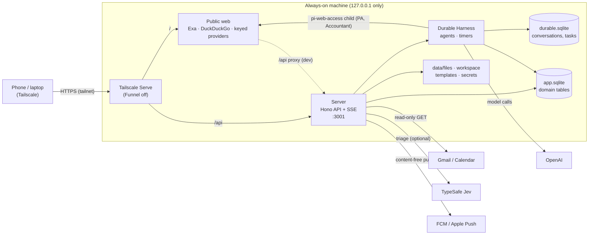

# Architecture

How Zimpoen is built. Section and rule numbers are stable: code comments cite them as `PLAN §5.4` or `PLAN rule 6`
(this file used to be `PLAN.md`). Reasoning behind individual decisions is in [design-notes.md](design-notes.md);
installation is [SETUP.md](SETUP.md).

## 1. Goal

An always-on personal assistant on an old Linux laptop, reached privately over Tailscale from a chat UI (installable as an
Android PWA). Each agent is one long-running Durable conversation:

| Agent | Purpose |
|---|---|
| `pa` | Front door: tasks, reminders, follow-ups, meeting agendas, birthdays, daily briefing and wrap-up, files. Can ask other agents. |
| `inbox` | Gmail (several accounts) and Google Calendar, read-only. Triage, digests, follow-up suggestions to the PA. |
| `health` | Weight, gym lifts, trends. |
| `accountant` | Expenses and income, balances, bill splits, invoices and other PDFs. |

Model and thinking level are per-agent settings, editable at runtime (stored in Durable via `configure()`). The model is
OpenAI through a ChatGPT subscription sign-in (pi-ai's "Sign in with ChatGPT"); tokens stay on the machine. Anthropic
subscription OAuth is not used: its consumer terms don't allow it.

## 2. Hard rules

1. **No outbound actions.** No tool sends email, posts messages, spends money or contacts anyone. Those tools don't exist.
   Gmail and Calendar use read-only scopes.
2. **Writes are local only:** `app.sqlite`, memory, and generated files in the workspace.
3. **Deletes need explicit approval** (Approve button or a literal "YES"), enforced in code by a `beforeTool` hook, not
   by the prompt.
4. **File access is an allowlist.** Read: `ASSISTANT_READ_PATHS` (default `~/Documents`, `~/Downloads`), `<data>/files`
   and the workspace. Write: `<data>/workspace` only. Always denied, in any case and after resolving symlinks: `.ssh`,
   `.env*`, `auth.json`, `*.pem`, `*.key`, `.netrc`, `.npmrc`, `.aws`, `.git-credentials`, `.gnupg`, `id_*`,
   `<data>/secrets/**`. Startup rejects a read path that would expose the databases.
5. **No shell on the host.** Documents are converted by the server itself (poppler, LibreOffice) with fixed
   arguments; no agent chooses what runs on the host. With `ZIMPOEN_SHELL=on` (default off) the PA, and bots given the
   `shell` preset, get `shell_run`, which runs only inside the agent's own gVisor container (§5.9). Never the Inbox.
6. **The Inbox agent has no file tools,** because it handles untrusted email. Its only tools are `search_mail`,
   `read_mail`, `list_events`, `mark_triage`, `propose_sender_rule`, `suggest_followup`, `recall` and `current_time`. No
   `tool_search`, no approval hook, no `ask_agent`. Email text is treated as data everywhere.
7. **Arithmetic is code, never the model:** splits, balances, totals, document numbers.
8. **Every tool write to `app.sqlite` is idempotent by tool call id** (`source_call_id UNIQUE`, or a per-module `*_call`
   table), because Durable may replay a tool after a crash.
9. **Secrets** (`credentials.json`, `vapid.json`, `google-oauth.json`, `google-accounts.json`, `jev.json`, `search.json`,
   `telegram.json`) live in
   `<data>/secrets/` (0700, files 0600) and are never readable by an agent.
10. **Server and web bind to `127.0.0.1` only.** Tailscale Serve is the only way in.
11. **The web is read, public only.** The PA and the Accountant have `web_search`, `fetch_content`,
    `get_search_content` and `source_check` from [pi-web-access](https://github.com/nicobailon/pi-web-access), run as an
    MCP child process with a clean environment and its own config in `<data>/web`. Its SSRF guard refuses loopback,
    private ranges, link-local and the tailnet; browser cookies, proxies and provider choice are not offered to agents.
    Web text is untrusted, like email. The Inbox has no web tools.

## 3. Topology



Outbound traffic is to those four services, plus public web pages and the search provider when the PA or the
Accountant searches or reads a page. Push payloads say things like "1 reminder" and never carry content.

Use a non-identifying machine name before enabling Tailscale HTTPS: certificate names are public in transparency logs.
Development uses `./data-dev` and production `./data`, so the two never share a database.

## 4. Repository layout

```text
apps/
  server/       Node 24 process: Harness, HTTP API, SSE, Web Push, Google sync
  web/          Next.js (App Router) + @assistant-ui/react, PWA
packages/
  shared/       API contracts: DTOs, SSE event types, card types
  db/           app.sqlite wrapper and migration runner
  extensions/   Domain modules (Durable extensions)
ops/            systemd units, Tailscale Serve and check scripts; coding-vm/ and computer-use/ (docs/coding-vm.md, docs/computer-use.md)
docs/
```

TypeScript strict, ESM. Workspace packages export source; Node 24 runs it directly in dev and `pnpm build` bundles the
server with esbuild. Tests use Vitest and pi-ai's faux provider (no network). Durable packages are pinned exactly; their
APIs are experimental.

## 5. Server

```ts
// apps/server/src/main.ts (shape)
const config = loadConfig();                       // validated; fails with every problem listed
const appDb = openAppDb(config.paths.appDb);       // node:sqlite, WAL
const domain = createDomain({ db: appDb, ... });   // the modules in §5.2
migrate(appDb, [...coreMigrations, ...domain.migrations]);
const harness = await Harness.open(storage, { models, registry, env: scopedEnvFor(config), ... });
await ensureAgents(harness, appDb, AGENTS);        // one conversation per agent, idempotent
harness.resume();
startHttp({ harness, appDb, config });             // 127.0.0.1 only
```

The port is bound before Durable opens and answers 503 "starting" meanwhile. `<data>/server.lock` ensures one server
per data directory.

### 5.1 Agents

```ts
type AgentId = "pa" | "inbox" | "health" | "accountant";
type AgentDef = {
  id: AgentId;
  name: string;
  defaultModel: { provider: string; modelId: string };
  defaultThinking: ModelThinkingLevel;
  extensions: Extension[]; // what the agent can do is exactly the tools it has
  instructions: string;
};
```

The `agents` table maps agent id to Durable conversation id.

Only the PA has `ask_agent(agent, question)`. It puts the question into the other agent's conversation (request id
`ask:<call id>`, so a replay doesn't ask twice), waits up to 90 s, and returns the answer. A later answer shows up as a
display-only card. Specialists can't reach each other. The Inbox reaches the PA only through the suggestion queue.

| Agent | Extensions |
|---|---|
| `pa` | `tasks`, `followups`, `people`, `approvals`, `daily`, `files`, `documents`, `delegate`, `routines`, `memory`, `tool_search`, `bots`, `broker` (unless `ZIMPOEN_CRED_BROKER=off`), `shell` (only with `ZIMPOEN_SHELL=on`) |
| `inbox` | `inbox`, `memory-read` |
| `health` | `health`, `approvals`, `memory`, `tool_search` |
| `accountant` | `ledger`, `splits`, `documents`, `files`, `approvals`, `memory`, `tool_search`, code mode |
| `cto` (only with `ZIMPOEN_CTO=on`) | `cto`, `broker` (only with `ZIMPOEN_CRED_BROKER=on`), `approvals`, `tool_search` |
| `bot:<slug>` | the presets the PA chose (`tasks-read`, `documents`, `web`, `memory`, `codemode`, `shell`), `approvals`, `tool_search` |

**Bots (upgrade §4).** The PA's `create_bot`, `delete_bot` and `list_bots` (deferred) manage up to 8 specialist bots. A
`bots_bot` row is authoritative: at every start the server gives each row a conversation (agent id `bot:<slug>`, built
by `botAgentDef` in `apps/server/src/agents.ts`) and archives the conversation of a bot whose row is gone (its agent key
is rewritten so it is never adopted again; durable.sqlite keeps it). Creating or deleting follows the PA's trust level
(Settings → Trust levels, else `ZIMPOEN_PA_TRUST`; `decide()` in `packages/extensions/src/trust.ts`): `normal` (default) and `strict` ask through the
approvals flow (actions `spawn_bot`, `retire_bot`), `open` runs and logs. Both tools refuse during a scheduled run (rule
13), through the `isScheduledRun()` routines use too (`packages/extensions/src/scheduled-run.ts`: daily job ids come from
`DAILY_JOBS`). `ask_agent` reaches bots
by id; bots have no `ask_agent`. Deleting a bot aborts its run, deletes its shell volume (when `ZIMPOEN_SHELL=on`: if the
engine fails the bot is kept and the delete can be repeated) and clears its memory scope and weekly limit. The `shell`
preset is refused while `ZIMPOEN_SHELL=off`, at creation, from the PA and from the Bots page alike.
The owner can also create and delete bots on the Bots page (`/api/bots`): no approval, same code (`createOwnerBots` in
`packages/extensions/src/bots/tools.ts`), so the cap, slug, soul and preset checks are the PA's.

**Trust levels.** Stored owner-only in `trust_setting` (`apps/server/src/trust-settings.ts`, a server table like
Telegram's: no tool can reach it), written only by `PUT /api/settings/trust/...`. Subjects are `pa` and `project:<id>`.
A stored level overrides the default (`ZIMPOEN_PA_TRUST` for the PA, the policy's `trust` for a project); `null` removes
it. Each real change also leaves a display-only note in the PA's thread. The bots tools and `cred_run` read the level at each call (`BotsDeps.trustLevel()`, `BrokerDeps.trustOf`), so a
change applies to the next call, and an approved `cred_exec` is checked against the level at approval time.

Code mode runs scripts in a QuickJS sandbox with no network, no files and no model calls. Each script has a time limit
(30 s by default, 2 minutes at most).

### 5.2 Domain modules

```ts
// packages/extensions/src/module.ts
type DomainModule = {
  name: string;                                           // also the prefix of its migration ids and tables
  migrations: readonly Migration[];                       // { id: "tasks/001_items", up(db) }
  extension: (deps: DomainDeps) => Extension;             // tools, prompt sections, hooks, Durable tasks
  actions?: (deps: DomainDeps) => readonly ApprovalAction[];   // destructive operations (§5.6)
  facts?: (deps: DomainDeps) => readonly DailyFactsProvider[]; // input to the daily jobs
};

type DomainDeps = {
  db: AppDb;
  timezone: string;
  now: () => number;              // the Harness clock
  harness: () => Harness;         // late-bound
  post: EntryPoster;              // display-only write into a conversation (§5.3)
  ask: InputSubmitter;            // a message that starts a model run, once per requestId
  notify: (p: PushPayload) => Promise<void>;
  approvals: ApprovalService;
  facts: () => readonly DailyFactsProvider[];
  // plus optional per-module config: files, schedule, health, accountant, inbox, delegate
};
```

A module never imports server code; everything comes through `DomainDeps`.

**Migrations.** Ids are `<module>/<NNN>[_name]`. Within a module they must be in order, and what a database recorded
must be a prefix of what the code declares. Adding a whole new module anywhere is fine. A database with an id the code
doesn't know is refused (old code, new schema).

**Tools.** TypeBox parameters; `output` is short text for the model, `details` is a typed card for the UI (types in
`packages/shared`). Rarely used tools are `deferred: true` and loaded through `tool_search`. A tool declares
`replay: "safe"` only when it satisfies rule 8.

### 5.3 Display-only posts

Reminders and system notices are written with `conversation.submit({ type: "write", requestId, entry: { kind, data } })`
using custom entry kinds (`app.reminder`, `app.notice`, ...). They never call the model. The `requestId` makes a repeated
post write once, so posting is safe to rerun after a crash.

**A post never carries model text.** Durable treats a write with model text as input for the next run, and in an idle
conversation with a queued message it would start that run, costing tokens on a reminder. So `EntryPoster` can't send
model text. What the model needs to know comes from the database through prompt sections. For example, the `tasks`
section lists reminders that fired for still-open tasks, so "snooze it" resolves.

### 5.4 Timers

Everything that waits for a time uses the same pattern: **the database row is authoritative; the Durable task is just a
timer.**

- The row says whether a timer is wanted and which generation (`gen`). The timer carries `{ id, gen }` and only acts
  while the row still has that generation.
- Rescheduling, completing or deleting changes only the row. A stale timer ends itself when it wakes.
- The generation is bumped in `app.sqlite` before the Durable task is created, so a rerun after a crash makes a newer
  generation and the orphan is stale.
- `reconcile()` runs at start and every 10 minutes: it recreates timers Durable lost (power cut) or ended (fault), row by
  row. A row it can't fix is logged with the SQL that clears it.
- A 30 s tick calls `harness.resume()` so timers that came due during suspend fire soon after wake.
- Timers are conversation-owned `background` tasks: Stop doesn't abort them and they don't mark the conversation busy.

| Timer | Task kind | Phases |
|---|---|---|
| Reminder | `app.reminder` | `wait → fire → notify` |
| Meeting / commitment | `app.followup` | `agenda_wait → agenda_ping → (nudge) → ask_wait → ask → reask_wait → reask` |
| Birthday (yearly) | `app.birthday` | `remind_wait → remind → check_wait → check`, then next year's cycle |
| Daily jobs | `app.daily` | `wait → run` |
| Gmail sync (per account) | `app.inbox-sync` | `wait → run` |
| Routine | `app.routine` | `wait → run` |

**Daily jobs:** morning briefing (07:30), evening wrap-up (21:00), inbox digests (12:30, 19:00). Times are settings
(`schedule_daily`). At run time, code gathers facts from every module's provider and sends them to the agent as one
request. With nothing to report it posts a card and makes no model call. A briefing that missed its time while the server
was down still runs until 11:00 (wrap-up until midnight, digests within 2 h). Each day runs at most once.

**Routines:** agent-proposed, owner-approved (`propose_routine` → Approve/YES → the server creates it; `list_routines` and
`cancel_routine` see only the calling conversation; PA only for now). Daily or weekly at HH:MM
in the owner's zone, or every N ≥ 1 hours; at most 20 active. A run is an `ask` with request id `routine:<id>:<slot ISO>`,
so a slot runs at most once. After downtime only the newest due slot runs; one more than 6 h late is skipped. A routine
whose agent is over its weekly token limit skips the slot. Rule 13: `isScheduledRun(harness, conversationId)`
(`packages/extensions/src/scheduled-run.ts`) is true while a `routine:` or daily-job input (parsed by `parseScheduledRequestId`) is placed in the
conversation's run; propose/cancel routine tools refuse then, and other self-propagating tools (bots, broker) should
call it too.

**Gmail sync:** first read is the last 14 days (≤ 1,000 mails), then `history.list`. Failures back off exponentially
(≤ 1 h). A refused token marks the account `needs_reconnect` and stops its timer.

Times are stored as UTC milliseconds; schedules are wall-clock times in `ASSISTANT_TIMEZONE` (default `Asia/Thimphu`).

### 5.5 HTTP API

All under `/api`, JSON. Errors are `{ error: { code, message } }`.

```text
GET    /agents                              agents + parked-task health
GET    /conversations/:id/stream            SSE: snapshot, then event batches; `ping` every 15 s
POST   /conversations/:id/messages          { content, requestId, whenBusy? } -> 202 (exact "YES" may answer an approval)
POST   /conversations/:id/abort
GET    /conversations/:id/messages?before=  history paging
GET    /settings/agents                     models available per agent
GET|PUT /settings/agents/:id                { model?, thinkingLevel? }
GET    /settings/schedule                   daily jobs
PUT    /settings/schedule/:job              { localTime?, enabled? }
GET    /settings/google                     accounts, triage mode
DELETE /settings/google/accounts            { email }: forget sign-in locally
PUT    /settings/budget/:agent              { weeklyTokens | null }
GET    /settings/trust                      PA and broker-project trust levels, with defaults
PUT    /settings/trust/pa                   { level: open|normal|strict | null }
PUT    /settings/trust/projects/:id         { level | null }; 404 for a project not in the policy
GET    /bots                                bots, cap, presets
POST   /bots                                { slug, name, avatar?, soul, tools[] } -> 201; 400 bad spec, 409 taken/full
DELETE /bots/:slug                          archive the bot's chat, clear its memory and limit
GET    /push/config                         VAPID public key
POST|DELETE /push/subscribe                 one device's subscription (≤ 20 devices)
POST   /approvals/:id                       { decision: "approve" | "deny" }
POST   /suggestions/:id                     { decision: "add" | "dismiss" }
POST   /admin/tasks/:id/retry               retry a parked task
POST   /uploads                             multipart, one `file`, ≤ 20 MB (the only non-JSON write)
GET    /files/:id                           an upload or generated file
GET    /profile, PUT /profile/preferences
GET    /memory, PATCH|DELETE /memory/:id
GET    /activity                            derived from transcripts, paged
GET    /usage                               token usage per agent, day and week
```

The web app also handles `POST /share` (Android share target, stores files then redirects to `/capture`).

**SSE.** `apps/server/src/stream.ts` is the only user of Durable's `watchEvents`. Each connection starts with a snapshot
(newest 200 entries), then batches every 100 ms while an answer streams. The browser reconnects after 40 s of silence;
reconnecting just gets a fresh snapshot. At most 8 streams are open.

**Request guards** (in both auth modes):

- `Host` must be a loopback name on the server's port or a name in `ASSISTANT_PUBLIC_HOST`. This blocks DNS rebinding.
- Writes marked `Sec-Fetch-Site: cross-site` are refused.
- Every write must be `application/json`, except `/uploads`, which instead *requires* `Sec-Fetch-Site: same-origin` or
  `none`.
- With `ASSISTANT_AUTH=on`, the peer must be loopback and `Tailscale-User-Login` must equal `ASSISTANT_OWNER_LOGIN`.
- JSON bodies are capped at 256 KB.

### 5.5a Telegram bridge

`apps/server/src/telegram/`, off unless `ZIMPOEN_TELEGRAM=on` (off starts nothing). The bot token is
`<data>/secrets/telegram.json` (`{ "token": "..." }`). A long poll (`getUpdates`, offset in `telegram_state`) reads
updates. While unbound, the server logs a one-time code; `/start <code>` from a private chat binds that chat, and every
other chat is ignored without an answer. Owner text goes to the PA as an input with request id `tg:<update_id>` (an exact
YES goes through `tryYes`, §5.6); when the run ends, its final text is sent back in 4096-char pieces, at most once
(`telegram_reply`, resumed after a restart). Voice notes (≤ 5 min, ≤ 10 MB) are converted by `ffmpeg` to 16 kHz mono WAV
and transcribed by whisper.cpp's `whisper-cli` with fixed argv (`ZIMPOEN_WHISPER_BIN`, `ZIMPOEN_WHISPER_MODEL`, both or
neither); only `[Voice note transcript] …` reaches the thread. No agent has a Telegram tool.

- A Telegram YES approves the one waiting request (rule 3, same `tryYes` window as the web) without the approval card
  being shown in Telegram: the owner approves from the chat context alone. Check the card in the web app when unsure.
- Voice notes are transcribed inside the poll loop, so text sent during a transcription (up to ~6 min) waits for it.
- A reply is retried with backoff when its first piece fails to send; once a piece went out it is never resent. A message
  that could not be passed on gets a "please send it again" answer. Text over 20 000 characters is cut, with a note.
- Open: the start code is printed to the server log and does not expire until a chat binds.

### 5.6 Approvals

`pending_actions` holds one row per request: tool, target (`task:t_ab12`), args, status
(`pending → approved → executed | failed`, or `denied`, `expired`), with a 24 h lifetime.

- A destructive action takes two steps. The model calls `propose_delete_*`, which creates the request and returns an
  approval card. Nothing is deleted yet.
- You answer with **Approve/Deny** or a message that is exactly **YES**. YES is handled by the server and only counts when
  exactly one request is waiting and you've sent nothing else since it was made.
- On approval, the server runs the action itself and posts the outcome as a display-only notice.
- **The hook is the enforcement.** A `beforeTool` hook blocks any registered destructive tool unless an approved request
  exists for that conversation, tool and target.
- At start, the server finishes approved requests a crash interrupted and re-posts missing outcome notices.

### 5.7 Credential broker (phase 1d)

`ZIMPOEN_CRED_BROKER=off|inprocess` (`on` means `inprocess`), default `off`: no tool, no approval action, nothing
read. The broker runs inside the server: there is no separate broker process, socket or user, and tokens are long-lived,
one per project (the broker never mints short-lived ones); see docs/OPS.md "Broker". The PA gets
`cred_run({ project, credId, action, params })` (module `packages/extensions/src/broker/`, server side
`apps/server/src/broker.ts`). It runs a fixed action from an owner-written policy with a credential the agent never sees;
there is no `get_secret`.

- **Policy** (`ZIMPOEN_CRED_POLICY`, default `<data>/secrets/broker/policy.json`), validated at start (a bad one stops the
  server, every problem listed): `projects [{ id, trust: open|normal|strict }]`, `credentials [{ id, project, secretRef }]`,
  `actions [{ id, argv, params: { name: regex }, inject: {type:"env",name} | {type:"stdin"}, sensitivity, maxOutputBytes,
  timeoutMs, strictDeny?, allowDashParams? }]`. `argv[0]` is absolute; `{name}` placeholders must be declared and match
  their regex in full. A value starting with `-` is refused unless `allowDashParams` (it would become an option). The env
  name may not be reserved (`PATH`, `LANG`, `HOME`, `LD_*`, `GIT_*`, ...).
- **Secrets:** in process, one file per `secretRef` in `<data>/secrets/broker/creds/` (dir 0700, files 0600, at least 8
  characters; refused otherwise).
- **Decision:** `decide(trust, sensitivity)`, where `trust` is the owner's level from Settings when set, else the policy's, in `packages/extensions/src/trust.ts` (plan §3). `allow` runs now; `ask`
  proposes an approval (`cred_exec` target) and the server runs it on Approve/YES, after checking the current policy
  again; `deny` refuses.
- **Run:** `spawn` with no shell in its own process group, env = `PATH`, `LANG` and the injected secret only; the timeout
  and output cap kill the whole group. Output is scrubbed (the secret as is, base64, URL-encoded, JSON-escaped, hex;
  `gh*_`, `github_pat_`, `sk-` tokens; Postgres URL passwords).
- **Rule 8:** `broker_call` keyed by tool call id. A replay returns the stored result; a run interrupted by a crash is
  reported as "may have run", never run again. Approved runs get the same row keyed `approval:<id>`, so startup recovery
  never repeats one either.
- **Audit:** append-only JSONL (`ZIMPOEN_CRED_AUDIT`, default `<data>/broker-audit.jsonl`), decisions and runs, no secret
  values.
- **Scheduled runs:** refused when the current run answers a `routine:`/`daily:` request (or a daily job's `<job>:<date>`),
  and when no current input can be found. This holds at every trust level, Open included, and for the CTO too.
- **The CTO's projects:** when the calling agent is the CTO, `project` must be one of its repos (`ZIMPOEN_CTO_REPOS`: the
  entry itself, or the name part of `owner/name`). Checked at the call and again when an approved `cred_exec` runs.
  The PA is not limited.

### 5.8 CTO (phase 3)

`ZIMPOEN_CTO=off|on`, default `off`: no agent, no tool. When on, a built-in `cto` agent hands coding work to the owner's
herdr-lead (module `packages/extensions/src/cto/`, server side `apps/server/src/cto.ts`).

- **Config:** `ZIMPOEN_CTO_REPOS` (required, comma list of `name` or `owner/name`), `ZIMPOEN_CTO_TRUST` (default normal),
  `ZIMPOEN_CTO_BOARD_BIN` (default `hc-board`), `ZIMPOEN_CTO_HC_BIN` (default `hc`).
- **Tools:** `delegate_coding({ repo, goal, doneWhen, outOfScope })` opens a card and tells the lead; `board_status({ card_id? })`
  reads cards it opened. Both go through the `CodingLead` interface; the server runs `hc-board`/`hc` with `execFile`, fixed
  argv and a minimal environment. Arguments are validated (repo allowlist, length caps, no leading `-`, no control characters).
- **Rule 8:** `cto_card` keyed by tool call id; the board call carries the same id as `--key`.
- **Rule 13:** `delegate_coding` refuses in a scheduled run (including an `ask_agent` question the PA asked from one)
  unless the CTO's trust is `open`.
- **Hub and spoke:** no `ask_agent`; the PA asks it with `ask_agent cto`. The owner's messages to its thread are refused
  (403), except a bare YES answering one of its approval requests. Push, merge and deploy are `cred_run` broker
  actions (§5.7), limited to the projects of its repos. Its approval cards stay in its own thread; they are not
  mirrored to the PA's.

### 5.9 Sandboxed shell (upgrade phase 4)

`ZIMPOEN_SHELL=off|on`, default `off`: no tool, no container engine touched. When `on`, `shell_run({ command,
timeoutSeconds? })` (deferred; module `packages/extensions/src/shell/`, server side `apps/server/src/shell.ts`) runs one
command per call in a fresh container of the calling agent:

- **Who:** the PA, and a bot whose `bots_bot` row has the `shell` preset (the PA must pick it; default no). The tool checks
  the caller's agent row on every call, so the Inbox is refused even if it were wired the tool.
- **Rule 13:** refused during a scheduled run, and when the run's origin is unknown (`runIsScheduled`).
- **Container:** `<engine> run --rm --pull=never --runtime=runsc --read-only --cap-drop=ALL
  --security-opt=no-new-privileges --pids-limit=128 --memory=512m --memory-swap=512m --cpus=1 --network=<net>
  --tmpfs /tmp --user=1000:1000`, image `ZIMPOEN_SHELL_IMAGE`, then `/bin/sh -c <command>`. The only mount is the
  agent's named volume `zimpoen-shell-<agent>` at `/workspace` (created once and chowned to 1000:1000); no host path, no
  host environment. The host runs the engine CLI with a fixed argv and `PATH`/`LANG` only; the command string is one
  argument that only the container's shell reads.
- **Limits:** 60 s by default, at most 300 s; on a timeout or past 64 KB of output the CLI is killed and the container
  force-removed. The command also runs under `timeout -s KILL <limit + 5 s>` inside the container, so it dies even if
  the server does, and at start the server force-removes every container labelled `zimpoen.shell=1`. The image must
  therefore have `timeout` (coreutils), `/bin/sh` and `chown`. The volume is chowned once per server process. A call is not `replay: "safe"`: a crash mid-run is reported, never run again.
- **Network:** `ZIMPOEN_SHELL_NETWORK=none` (default) or a dedicated network filtered by `ops/shell-egress.sh` (nftables or
  iptables; run as root, after every boot). It creates the network on bridge `zs-br0` if missing, drops everything from
  the bridge to the host and between sandboxes, and forwarding to 10/8, 172.16/12, 192.168/16, 169.254/16, 127/8,
  100.64/10, fc00::/7, fe80::/10 and fd7a:115c:a1e0::/48, then writes `/run/zimpoen-shell/egress.ok`. Containers on a
  network use 1.1.1.1 and 9.9.9.9 for DNS. `host`, `bridge` and `container:*` are refused by config.
- **Start-up check:** a probe container with the full flags must run (no `runsc` runtime or no pulled image stops the
  server). With a network, the marker must exist, be root-owned and not group/world writable, name the network, list
  every range above, and its bridge must be the network's. Every problem is listed and the server refuses to start.
- **Settings:** `ZIMPOEN_SHELL_ENGINE` (`podman` default, rootless; or `docker`), `ZIMPOEN_SHELL_BIN` (default `/usr/bin/<engine>`),
  `ZIMPOEN_SHELL_IMAGE` (default `docker.io/library/debian:stable-slim`; pull it first), `ZIMPOEN_SHELL_NETWORK`,
  `ZIMPOEN_SHELL_EGRESS_MARKER`.
- **Host access:** the engine is rootless Podman run by the server's own user, so no docker group (which would be
  root-equivalent). The server unit's sandboxing may still block it, and the egress network below is for a rootful engine:
  rootless Podman's networks live in the user's own namespace, where the host rules of `ops/shell-egress.sh` do not
  apply, so with rootless Podman keep `ZIMPOEN_SHELL_NETWORK=none` (the default). Not tested on a real host.
- **Egress:** a blocklist of private, loopback, link-local, tailnet and host ranges (above); no allowlist of
  destinations.
- **Deleting a bot** removes its volume (`ContainerRunner.removeVolume`); a missing volume is not an error.

## 6. Web

Next.js App Router with `@assistant-ui/react` (`useExternalStoreRuntime`), a zustand store fed by `EventSource`.

- **Sidebar:** agents with busy indicator.
- **Thread:** one endless chat per agent. Display-only entries render as system cards; tool results render as typed cards
  (approvals, tasks, health charts, spending bars, split bills, invoices, mail lists, suggestions). Charts are plain SVG.
- **Composer:** text, attachments (each uploads as it's picked, up to 10 per message), stop.
- **Pages:** Settings (agent models, daily schedule, Google accounts, trust levels, notifications), Profile (memory
  editor, tone), Activity, Usage (weekly limits), Bots (list, create, delete).
- **PWA:** manifest, generated icons, `sw.js` for push (no caching), Android share target. iOS delivers push only to an
  installed web app.
- A banner reports tasks Durable parked after repeated crashes, with a Retry button.

## 7. Data model

`app.sqlite` holds the domain tables. Each module owns tables prefixed with its name (except `schedule_daily` and
`pa_journal`), plus a `*_call` ledger for rule 8. The full schema is in each module's `migrations.ts`.

| Module | Main tables |
|---|---|
| core | `_migrations`, `agents`, `push_subscriptions` |
| approvals | `pending_actions` |
| tasks | `tasks_item`, `tasks_call` |
| followups | `followups_item`, `followups_agenda`, `followups_call` |
| people | `people_person`, `people_wish`, `people_call` |
| daily | `schedule_daily`, `pa_journal`, `daily_call` |
| files | `files_index`, `files_call` |
| memory | `memory_fact` + FTS5 `memory_fact_fts` |
| usage | `usage_baseline`, `usage_day`, `usage_seed`, `usage_budget` |
| health | `health_weight` (one per day), `health_exercise`, `health_session`, `health_set`, `health_call` |
| ledger | `ledger_account`, `ledger_category`, `ledger_txn`, `ledger_balance_snapshot`, `ledger_fx`, `ledger_import`, `ledger_recategorization*`, `ledger_call` |
| splits | `splits_bill`, `splits_item`, `splits_share`, `splits_settlement` |
| documents | `document_series`, `document_numbers`, `documents_made`; the retired invoice module's `invoice_profile`, `invoice_issued`, `invoices_call` are kept |
| inbox | `inbox_account`, `inbox_message` + FTS5, `inbox_event`, `inbox_rule`, `inbox_suggestion`, `inbox_digest`, `inbox_read_failure`, `inbox_state`, `inbox_call` |
| delegate | `delegate_ask` |
| bots | `bots_bot`, `bots_call` |
| telegram (server, not a module) | `telegram_state` (poll offset, bound chat, one-time start code), `telegram_reply` |
| trust (server, not a module) | `trust_setting` (owner's trust levels: `pa`, `project:<id>`) |
| routines | `routines_routine`, `routines_call` |
| broker | `broker_call` |
| cto | `cto_card` |

Conventions:

- Money is `INTEGER` minor units in `STRICT` tables, never floats.
- Weight is kilograms.
- Times are UTC epoch ms; local calendar days are `YYYY-MM-DD` text.
- Ids are short prefixed strings (`t_`, `f_`, `p_`, `fi_`, `m_`, `x_`, `b_`, ...).

## 8. Known gaps

**Not yet tested against the real services** (built and tested against fakes only):

- Tailscale Serve flags and stored config; HTTPS availability on your plan
- systemd hardening against a real start
- `pnpm login:openai` against the real ChatGPT sign-in, and whether its responses report token usage
- Push delivery through FCM and Apple
- Google REST edge cases (history 404, loopback redirect) and the 7-day expiry in Testing mode
- Jev's request/response shape (`triage/jev-contract.ts`, marked `TODO(verify)`)
- A real model following the memory, inbox, digest and `ask_agent` instructions
- The Android share target on a device

**Open:**

- Backups are not automated.
- A page fetched from the web can carry instructions aimed at the model. They are marked untrusted and destructive tools
  need approval, but a page could still nudge an agent into an unapproved write (a task, a memory fact), or into putting
  something it knows in a URL it fetches.
- A numbered document keeps no copy of its HTML, so a lost PDF can't be regenerated under the same number. Back up
  `workspace/documents/`.
- `record_settlement` doesn't write a ledger entry for your side of a payment.
- An upload interrupted between file rename and row insert leaves an orphan file; nothing sweeps them.
- A replayed `remember` after you deleted its line recreates it (needs a crash and a delete in the same window).
- `search_files` is a plain word match with no ranking.
- `experimental.proxyClientMaxBodySize` (Next) may be renamed in an upgrade.
